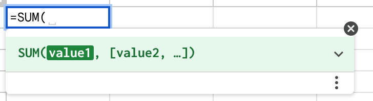
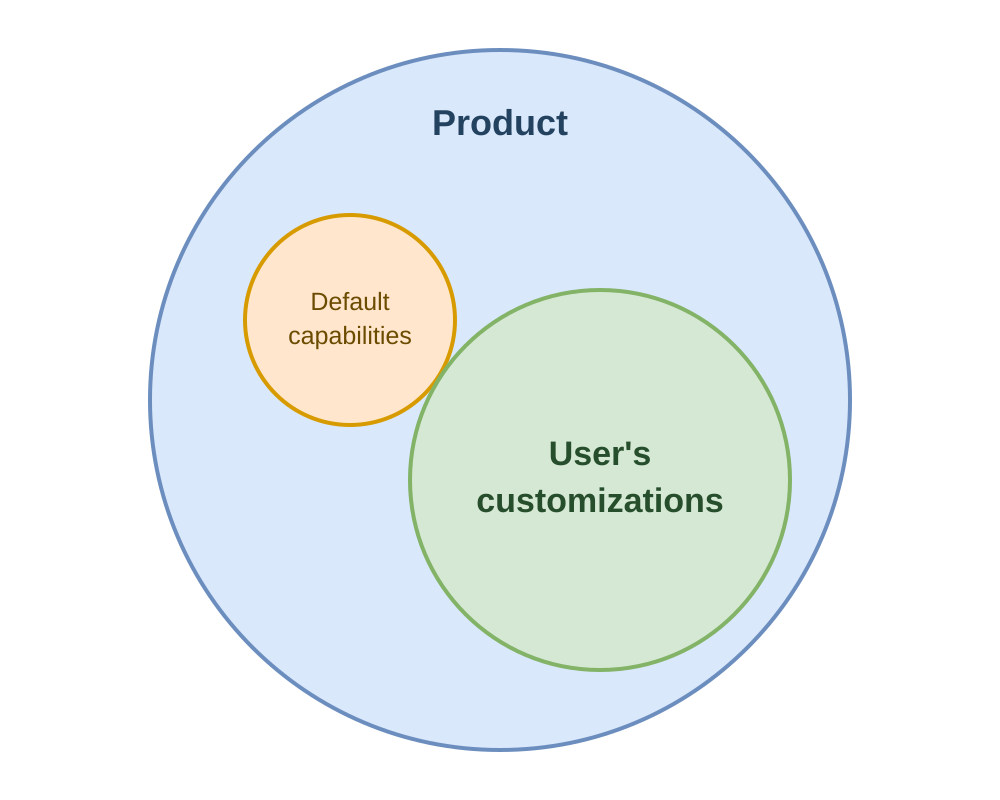

- date: 28 Oct 2026, 12:00
- slug: customizable-products

# Customizable products: AI that customizes from within

{style="max-width:100%;"}

I love macros and formulas in Excel. You type `=SUM(A1:A100)`, and the spreadsheet calculates the result. Drag the
formula to the next column, and it works there too. With a few expressions, people can make Excel perform calculations
that its developers never designed for their particular business.

The important part is not the formula itself. **It is that the user's logic lives inside the product**. The spreadsheet is
no longer just a grid of cells supplied by Microsoft. It has become someone's calculator, planning tool, or accounting
system.

This kind of customization is not new. Excel has macros, games have scripting, databases have query languages, and Emacs
can be reshaped through extensions. These products give users room to add their own logic instead of limiting them to
the features that came in the box.

I recently built a small game around this idea. In [BOTSCRIPT Arena](https://github.com/lezhnev74/botscript_game),
**players do not steer their bots directly**. Each player writes a program that can scan the room, move, collect coins, and
fire. Once the program is submitted, the game runs it. The player improves the bot by changing its logic, not by
clicking faster.

[](https://github.com/lezhnev74/botscript_game)

*BOTSCRIPT Arena: players write the bots' programs, and the game runs
them. [Source code and rules](https://github.com/lezhnev74/botscript_game).*

[Live Arena is at https://botscript.lessthan12ms.com/](https://botscript.lessthan12ms.com/)

**The game is an exaggerated version of what I want from other products**. It provides a small world with clear rules,
useful data, and a limited set of actions. The player's program supplies the behavior inside that world. A CRM, banking
app, or delivery service could offer its customers a similar kind of room, with deals, transactions, or orders instead
of bots.

**Most products offer the opposite:** settings to choose and integrations to connect, but no room for the customer's own
logic.

## The features that never ship

A product team cannot build everything its customers ask for. Developers evaluate feature requests, estimate their
value, and work on the ones that serve enough users. A request shared by thousands of customers may make the roadmap. A
request that matters to one business, or even to one person, usually does not.

This is an economic decision. **Building and maintaining a feature costs money, so the long tail of customer needs goes
unserved.**

Products often offer an API as a way out. The customer can hire developers, read the documentation, and build the
missing automation outside the product. Sometimes a tool such as Zapier or n8n is enough. Sometimes the solution grows
into a small system with its own server, database, scheduled jobs, and credentials.

The customer gets the missing functionality, but also gets a new piece of software to own. APIs change, credentials
expire, jobs fail, and external services must be kept running. The logic that matters to the customer ends up scattered
across scripts, integration accounts, cron jobs, and spreadsheets.

Both routes are constrained by the same cost. Either the vendor's developers build the feature inside the product, or
someone else's developers build and maintain it outside.

## AI changes the cost of authoring

LLMs make it much cheaper to produce code. They can read API documentation, write integration scripts, and increasingly
operate software through its user interface. A personal agent with connectors can automate work across several products
without requiring the customer to hire a development team.

All of this helps, but it stays on the outside route. The agent still drives the product through an API or a browser.
The automation still lives somewhere else, and the customer still has to trust that it uses the right data, keeps
working after an update, and does only what it was asked to do.

**Writing the code is only one part of the problem.** The code also needs a place to run, access to data, permissions,
monitoring, and a way for its owner to understand and change it.

A general agent knows a little about every product. The product knows its own data, actions, permissions, and failure
modes in detail. Can the product use AI to offer something better within its own domain?

## Let the product host the customization

**What if a customer could describe the feature they need, let AI turn that description into a program, and have the
product host the result?**

The program would live inside the product, using its data and actions and running with the customer's permissions. AI
would be the author of the customization, not a permanent participant in its execution.

{style="max-width:100%;"}

*User customizations can become a larger part of the product than its default capabilities.*

Consider a few examples.

In a water delivery app, a customer could say:

```
Every 14 days after my last delivery, ask me on Telegram whether I want to reorder. 
If I say yes, create the same order and send me a payment link. If I say no, ask when you should remind me again.
```

In a CRM, a sales team lead could say:

```
Monitor all deals in my department. If a deal has no updates for 7 days, notify its manager. 
If there are still no updates after 14 days, escalate it to the director.
```

In a banking app, a customer could say:

```
Watch my purchases for anything that looks like a subscription, and notify me when the total passes $500 in a month.
```

None of these requests requires a new button designed by the vendor. **Nobody at the company has to put the feature on a
roadmap, implement it, and release it to everyone.** The customer describes the behavior, and the product gains a small
piece of functionality for that customer.

None of this requires programming knowledge: the customer writes ordinary prose, and AI turns it into an executable
form. Once the customization is accepted, it can run for months or years without an LLM in the loop. AI returns when the
customer wants to change it.

## Why this matters for retention

Hosting customizations changes more than feature economics. It changes what the product accumulates over time.

A conventional product stores the customer's data and settings. A customizable product can also store part of the
customer's way of working: their reminders, escalation rules, calculations, views, and workflows. Each useful
customization makes the product fit that customer a little better.

**That creates a different retention mechanism.** A competitor may be able to import the customer's orders, deals, or
transactions. Data migration alone does not reproduce the behavior that has grown around that data. Replacing the
product now means replacing the workflows it runs as well.

AI makes these customizations cheap to create, but AI is not the retention mechanism by itself. The persistent programs
are. Their value continues after the AI session is over.

This does not have to become lock-in through obscurity. Customizations should be understandable, exportable, and owned
by the customer. The strongest reason to stay is not that leaving is impossible. It is that the current product has
gradually become more useful than its default replacement.

## What a product must provide

The promise is easy to describe and much harder to run safely. A vendor cannot simply accept generated code from a chat
window and execute it alongside its core systems.

**A product needs four things:**

1. A language in which AI can express customizations.
1. A catalog of the data and actions those customizations may use.
1. A runtime that can host them reliably and within limits.
1. A playground where the customer can inspect and test them before activation.

The last requirement deserves special attention. The hardest problem is not always producing a program. It is
establishing that the program does what the customer meant.

This problem existed with human programmers, and AI does not remove it. A customer may say "notify me when a deal is
idle for 7 days" without considering whether receiving a notification counts as an update, what happens on weekends, or
whether a closed deal should reset the timer. Generated code can compile and still implement the wrong interpretation.

A non-programmer cannot resolve this by reviewing the source code. The product must generate an explanation from the
program itself, show what will happen and what will not, and let the customer try realistic scenarios. It should also
support dry runs against past data: "This rule would have fired 37 times last month." Every action should be traceable
back to the customization and the event that caused it.

The platform can also warn about behavior that is valid but unexpected. Based on past data, it might say, "This
notification would have fired every 2 hours." By examining the workflow, it might find that a customer who never answers
remains stuck forever, that one event can notify the same manager twice, or that a threshold can trigger again on every
new transaction.

These are not syntax errors. They are consequences the customer may not have imagined while writing the request.

Static checks can show that a program is valid. They cannot show that it is faithful to the request. Preview, dry runs,
clear explanations, and undo are therefore part of the feature, not optional tooling around it.

## Why the execution language should be small

AI could write JavaScript or Python for these customizations. The product could then try to make the result safe with a
sandbox, resource limits, and code inspection.

**A general-purpose language makes this difficult because it can express far more than the customization needs.** Files,
network access, processes, and arbitrary computation are all outside the customer's actual request. The host must
repeatedly decide what to block, and every escape from the sandbox becomes a security problem.

Excel formulas show the idea. A formula can read cells, calculate values, and call the functions the spreadsheet
provides. It cannot open a network connection and hack the Pentagon. Its usefulness comes from having the right
operations inside a bounded world, not from having access to the whole computer. I want the same boundary for product
customizations, with a richer set of operations than cells and arithmetic.

A small closed language starts from the opposite end: it contains only what a customization needs. There is no general
file or network access. The only way to affect anything is through a declared product capability. Every query runs
within the customer's data permissions, and every action is checked against the actions that customer is allowed to
perform.

The language can be typed using the product's own domain types. Its computations can be bounded and, where practical,
required to terminate. The checker can then reject many invalid programs before they run.

This language is not the customer's interface. The customer uses prose, previews, and explanations. **AI uses the language
as a precise intermediate form between the request and the product's runtime**. It should have a small specification, one
clear way to express each operation, and errors that help the model repair its output.

A closed language limits what a program may do. It does not prove that the program does the right thing. That is why the
language and the playground solve different problems, and why both are necessary.

## The common machinery inside a customization

The examples look unrelated because they belong to different products. Their underlying behavior is similar.

The water delivery request starts with a timer relative to the last delivery. It waits for a typed answer from the
customer, branches on that answer, and either calls product actions or schedules another reminder.

The CRM request creates state for each deal. Deal updates reset an idle timer. Entering the warning or escalation state
sends a notification, while closing or updating the deal changes the state.

The banking request reads transactions through a query, classifies and aggregates them within a time window, and turns a
threshold crossing into a notification.

Across the examples, **the same machinery appears: events, timers, state, durable workflows, queries, thresholds,
conversations, and notifications**. A program may wait for days, but it must survive restarts and continue from the right
state. It may perform an action, but retries must not place the same order twice.

```text
                        Customer's prose
                              |
                              v
                         [AI author]
                              |
                              v
                  +-----------------------+
                  | Customization program |
                  | in a small language   |
                  +-----------------------+
                              |
          +-------------------+-------------------+
          |                   |                   |
          v                   v                   v
+----------------+  +-----------------+  +----------------+
| WHEN           |  | REMEMBER & READ |  | DO & SHOW      |
| events         |  | state           |  | product actions|
| timers         |  | workflows       |  | messages       |
| thresholds     |  | queries         |  | views          |
+----------------+  +-----------------+  +----------------+
          \                   |                   /
           +------------------+------------------+
                              v
               +-------------------------------+
               | Product runtime               |
               | permissions, limits, retries, |
               | durable state, traces, replay |
               +-------------------------------+
```

Only the domain vocabulary changes. One product has deliveries and payment links, another has deals and managers, and
another has transactions and spending categories.

The product supplies that vocabulary through its data, events, and actions. The platform supplies the machinery that
lets a small program react, wait, read, and act.

The same machinery can support more than background automation. A query can feed a custom view, a calculation can become
a derived field, and a workflow can include a form for approval. The customer can then change both what the product does
and how it presents information.

## One platform, many products

The generic machinery is substantial. A product team would need a language and checker, a durable runtime, query
execution with permission checks, quotas, tracing, dry runs, replay, and tools for explaining stored programs. Building
all of this separately for every CRM, bank, store, and delivery service would repeat most of the work.

**This suggests a shared platform for customizable products.** The platform would own the language, runtime, verification
tools, and limits. Each product would connect its domain catalog: customer-facing data schemas, events, actions,
identity, communication channels, and views.

The division of labor would be similar to the way products use a database or a durable workflow engine. Most teams do
not build their own Postgres or Temporal. They build the domain-specific part on top of a shared system.

There is also a case for making this platform open source. The engine becomes part of the product's trusted base, so
vendors need to audit it. A public language and catalog specification would let different models generate customizations
without depending on one AI provider. Shared development would also concentrate the difficult work of security,
migration, and runtime correctness in one place.

External APIs would not disappear. Some workflows genuinely span independent products, and outside integration remains
the right tool for them. The difference is that an API would no longer be the only way to obtain behavior the vendor did
not build.

> **Is it time to build this platform in the open, so product teams can adopt it and improve it together?**

## The product's new role

Developers would not stop building features. Good defaults would still matter, both as complete experiences for new
customers and as examples of what can be customized. Popular customizations could eventually become built-in features.

But the developer's job would expand beyond predicting and implementing every request. The product team would design
useful capabilities, define their permissions and limits, and make them compose safely. Built-in features could become
presets that customers keep, modify, or replace.

Customers, with AI doing the translation, would serve more of their own long tail. The vendor would no longer have to
choose between rejecting an unusual request and maintaining a feature for one account.

**That is the opportunity I see in customizable products**. AI writes the customization once. The product keeps delivering
its value every day afterward. Over time, the product contains not only the customer's data, but also the functionality
that makes it theirs.